# GRAVITY GONE 🚀

### The floor is no longer mandatory.

**A momentum-driven gravity puzzle from Beura Labs.**

Swipe to change gravity. Keep your momentum. Dodge the mines, collect starbits, and guide a tiny astronaut to the portal. Gravity Gone is a fast, mobile-friendly space puzzle game you can play right in your browser.

<strong><a href="https://gravity-gone.vercel.app">▶ Play Gravity Gone · gravity-gone.vercel.app</a></strong>

  
  
  
  

---

## 🌌 What is Gravity Gone?

Gravity Gone is an **arcade-style physics puzzle game** where you don't steer the astronaut directly. You change the direction of gravity, then let momentum do its thing.

Swipe left, right, up, or down to redirect gravity. The astronaut keeps moving, slides across the level, and only stops when the world gives them a reason to. Find a path through compact space mazes, collect glowing starbits, avoid dangerous mines, and reach the portal with as few gravity changes as possible.

It starts simple. Then your intuition about which way is “down” becomes deeply unhelpful. Perfect.

## ✨ Why play?

- **Gravity is the controller.** Change the direction of pull instead of manually moving the astronaut.
- **Momentum matters.** Plan your slides, use walls to stop, and think a few moves ahead.
- **12 progressive levels.** Unlock the route one stage at a time, with later layouts generated from deterministic level logic.
- **Starbit hunting.** Collect optional glowing starbits and build satisfying chains.
- **Mine dodging.** One bad line through a level can send your little spacefarer right back to the start.
- **Three-star scoring.** Finish with fewer gravity changes to earn a better rating.
- **Cosmic feedback.** Enjoy particle bursts, screen effects, sound cues, and a tiny synth-like music loop.
- **Your game, your settings.** Toggle sound and music, choose swipe or tap controls, adjust visual quality, and reduce motion.
- **Made for small screens.** Touch-first controls, responsive canvas rendering, and phone-friendly menus.
- **Quick to start.** No account, app installation, or download required to play the live browser version.

## 🕹️ How to play

1. **Change gravity.** Swipe in the direction you want gravity to pull the astronaut.
2. **Ride the momentum.** You keep moving even after changing gravity, so use walls and corridors to control your slide.
3. **Collect starbits.** Grab the glowing collectibles along your route.
4. **Avoid mines.** Touching one resets your current run.
5. **Reach the portal.** Finish the level, earn your stars, and continue to the next stage.

The goal is not simply to find a path. It is to find a good path.

## 🎮 Controls

| Input | Action |
| --- | --- |
| Swipe up / down / left / right | Change the direction of gravity |
| Tap | Rotate gravity when **Tap** mode is enabled in Settings |
| Arrow keys | Change gravity in the matching direction |
| WASD | Alternative keyboard controls |
| R | Restart the current run |
| P or Escape | Pause or resume |
| Enter or Space | Continue from the completion screen |

On touch devices, swipe mode is the default. On a keyboard, use the arrow keys or WASD. Change the input style at any time in **Settings**.

## ⚙️ Performance on everyday devices

Gravity Gone uses a lightweight **HTML5 Canvas 2D renderer** and caps its internal pixel ratio to control rendering cost. Rendering quality also limits particle and background-star counts, so the game can scale down on entry-level phones and older laptops.

| Quality | Best for |
| --- | --- |
| **Low** | Older phones, entry-level hardware, or maximum battery friendliness |
| **Balanced** | A practical everyday setting |
| **High** | More capable devices that can handle extra particles and detail |

For the smoothest experience on a low-end device, start with **Low** quality. Performance still depends on the browser, display resolution, GPU, and thermal conditions.

Prefer a calmer screen? Enable **Reduce motion** in Settings. The game also respects the device's reduced-motion preference for selected visual effects.

## 💾 Progress and privacy

- Level unlocks, best star ratings, fastest completion times, starbit records, and settings are saved in your browser's local storage.
- No account is required.
- Game progress is local to the browser and device. Clearing site data or changing browsers can remove or separate that progress.
- The game does not need a dedicated application server to run its core puzzle mechanics.

The page requests Google Fonts for its visual styling; system-font fallbacks are defined in the source for environments where those fonts do not load.

## 🧑‍🚀 The astronaut

The explorer is drawn directly by the game's Canvas renderer, so the character is part of the game rather than a heavy external sprite. The README banner and animated launch artwork are separate decorative SVGs; the original game file remains untouched.

## 🧰 Technology

- **HTML5** for the game shell
- **CSS** for responsive screens, menus, and neon space styling
- **Vanilla JavaScript** for physics, level state, input, scoring, audio, and progression
- **Canvas 2D** for the space scene, maze, astronaut, effects, and particles
- **Local storage** for local progress and preferences
- **Vercel** for hosting the browser game

## ▶ Play online

Ready to bend the rules of down?

**[Launch Gravity Gone](https://gravity-gone.vercel.app)**

The game opens directly in a modern browser on phones, tablets, laptops, and desktops. No download or account is required.

## 🖥️ Run it locally

The game is self-contained in a single HTML file.

1. Clone or download this repository.
2. Open `index.html` in a modern browser.
3. Tap the screen to enter the menu, then launch a level.

No package installation or build step is required. A local static web server can be used if you prefer to serve the file over HTTP.

## 📦 Repository contents

| Path | Purpose |
| --- | --- |
| `index.html` | Original, self-contained Gravity Gone game |
| `assets/gravity-gone-banner.svg` | Custom astronaut and space-puzzle banner artwork |
| `assets/launch-button.svg` | Animated astronaut-themed launch badge for this README |
| `LICENSE` | Proprietary all-rights-reserved notice |

## 📜 License and rights

**Gravity Gone is proprietary software. All rights are reserved by Satyajit Beura.** No licence to reuse, modify, redistribute, or create derivative works is granted by default. See [LICENSE](LICENSE) for the full notice.

The project name, original game source, code, game interface, and associated project artwork are not released under an open-source licence.

---

**BUILT BY BEURA LABS**  
*One tiny astronaut. Twelve levels. Absolutely no obligation to respect gravity.*

<a href="https://gravity-gone.vercel.app">Play Gravity Gone ↗</a>

