<div align="center">


<br />

# GRAVITY GONE

### The floor is no longer mandatory.

**A momentum-driven gravity puzzle from Beura Labs.**<br />
Swipe to change gravity. Keep your momentum. Dodge the mines. Reach the portal.

<br />

<a href="https://gravity-gone.vercel.app">
  
</a>

<sub>No download. No account. Works on phones, tablets and desktops.</sub>

<br />

<p>
  <a href="https://gravity-gone.vercel.app"></a>
</p>

<p>
  
  
  
  
  
</p>

<p>
  <a href="#-what-is-gravity-gone">About</a> &nbsp;·&nbsp;
  <a href="#-gameplay">Gameplay</a> &nbsp;·&nbsp;
  <a href="#%EF%B8%8F-how-to-play">How to play</a> &nbsp;·&nbsp;
  <a href="#-controls">Controls</a> &nbsp;·&nbsp;
  <a href="#-scoring">Scoring</a> &nbsp;·&nbsp;
  <a href="#-run-it-locally">Run locally</a> &nbsp;·&nbsp;
  <a href="#-faq">FAQ</a>
</p>

</div>

---

## 🌌 What is Gravity Gone?

Gravity Gone is a fast, arcade-style **physics puzzle** where you never steer the astronaut directly. You only choose which way gravity pulls, then momentum does the rest.

Swipe left, right, up or down and your little spacefarer slides until a wall stops them. Plan your route through compact space mazes, grab glowing starbits, avoid the mines, and reach the portal using as few gravity changes as you can.

It starts easy. Then your sense of which way is "down" becomes deeply unhelpful. Perfect.

## 📱 Gameplay

<div align="center">

<a href="https://gravity-gone.vercel.app">
  
</a>

<sub><b>Level 8</b> · slide, dodge the red mines, collect the golden starbits, and hit the cyan portal.<br />Illustration rendered from the game's real level data. <a href="https://gravity-gone.vercel.app">Play it live</a> to see the real thing.</sub>

</div>

### What you'll see on screen

| | Element | What it does |
| :---: | --- | --- |
| 🧑‍🚀 | **Astronaut** | That's you. You slide in the direction gravity pulls until something stops you. |
| 🟨 | **Starbit** | Optional golden collectible. Grab them in quick succession to build a chain. |
| 🔴 | **Mine** | Touch one and your run resets. Plan your slides around them. |
| 🌀 | **Portal** | Your goal. Slide into it to finish the level. |
| 🟦 | **Walls** | They stop your slide. Use them as brakes. |

## ✨ Features

| | |
| --- | --- |
| 🧲 **Gravity is the controller** | Change the pull direction instead of moving the astronaut by hand. |
| 🏃 **Momentum matters** | Think a few slides ahead and use walls to stop exactly where you want. |
| 🧩 **12 progressive levels** | Each stage unlocks the next. Early levels teach, later ones test you. |
| 🧠 **Built-in solver** | The game calculates the best possible number of gravity changes for every level. |
| 💎 **Starbit chains** | Collect starbits back to back for satisfying chain bonuses. |
| ⭐ **Three-star scoring** | Fewer gravity changes means a better rating. |
| 🎆 **Cosmic feedback** | Particle bursts, screen effects, sound cues and a tiny music loop. |
| ⚙️ **Your rules** | Toggle sound and music, pick swipe or tap controls, set visual quality, reduce motion. |
| 📲 **Made for phones** | Touch-first controls, responsive canvas and thumb-friendly menus. |
| ⚡ **Instant start** | One page, no installs, no accounts. |

## 🕹️ How to play

1. **Change gravity.** Swipe in the direction you want gravity to pull.
2. **Ride the momentum.** You keep sliding after each swipe, so use walls and corridors to control where you stop.
3. **Collect starbits.** Pick up the golden collectibles along your route.
4. **Avoid mines.** Touching one resets your current run.
5. **Reach the portal.** Finish the level, earn your stars, and move on to the next.

> The goal is not just to find a path. It's to find a *good* path.

## 🎮 Controls

| Input | Action |
| --- | --- |
| Swipe up / down / left / right | Change the direction of gravity |
| Tap | Rotate gravity (when **Tap** mode is on in Settings) |
| Arrow keys or WASD | Change gravity in that direction |
| R | Restart the current run |
| P or Esc | Pause or resume |
| Enter or Space | Continue from the level-complete screen |

Touch devices use swipe controls by default. You can switch input style any time in **Settings**.

## ⭐ Scoring

Every level has a best-possible route. Your stars depend on how close you get to it.

| Stars | You earn them when |
| :---: | --- |
| ⭐⭐⭐ | You finish within **1 gravity change** of the best route |
| ⭐⭐ | You finish within **4 gravity changes** of the best route |
| ⭐ | You reach the portal at all |

The level-complete screen also shows your **time**, **gravity changes** and **starbits collected**. With 12 levels there are **36 stars** to chase.

### Pro tips

- Look at the whole maze before your first swipe. Dead ends are your friends if they stop you in the right spot.
- A wall next to a mine is a free brake. A mine next to a path is a free reset. Know the difference.
- Stuck? Restart with **R**. Resets are instant and unlimited.
- Chasing 3 stars? Plan the route first, then collect starbits on the way.

## ⚙️ Performance on everyday devices

Gravity Gone uses a lightweight **HTML5 Canvas 2D** renderer and caps its internal pixel ratio to keep rendering cost low. Quality settings also scale particle and background-star counts, so it can run on entry-level phones and older laptops.

| Quality | Best for |
| --- | --- |
| **Low** | Older phones, budget hardware, or maximum battery life |
| **Balanced** | A solid everyday setting |
| **High** | Capable devices that can handle extra particles and detail |

Prefer a calmer screen? Turn on **Reduce motion** in Settings. The game also respects your device's reduced-motion preference for selected effects.

## 💾 Progress and privacy

- Level unlocks, best stars, fastest times, starbit records and settings are saved in your **browser's local storage**.
- No account is needed and nothing is uploaded.
- Progress stays on that browser and device. Clearing site data or switching browsers resets it.
- The core game needs no application server to run.
- The page loads Google Fonts for styling. System-font fallbacks are built in if they don't load.

## 🧰 Under the hood

| Layer | Tech |
| --- | --- |
| Game shell | **HTML5** |
| Styling | **CSS** with responsive screens, menus and a neon space theme |
| Logic | **Vanilla JavaScript** for physics, level state, input, scoring, audio and progression |
| Rendering | **Canvas 2D** for the maze, astronaut, effects and particles |
| Saves | **Local storage** |
| Hosting | **Vercel** |

Everything lives in a single self-contained `index.html`. No frameworks, no bundler, no build step.

## 🖥️ Run it locally

```bash
git clone https://github.com/SatyajitBeura2468/GravityGone.git
cd GravityGone
```

Then open `index.html` in any modern browser. That's it.

Prefer a local server? Any static server works, for example:

```bash
python3 -m http.server 8000
```

Then visit `http://localhost:8000`.

## 📦 Repository contents

| Path | Purpose |
| --- | --- |
| `index.html` | The complete Gravity Gone game |
| `assets/gravity-gone-banner.svg` | Astronaut and space-puzzle banner artwork |
| `assets/launch-button.svg` | Animated launch button for this README |
| `assets/gameplay.svg` | Animated gameplay illustration for this README |
| `LICENSE` | All-rights-reserved notice |

## ❓ FAQ

<details>
<summary><b>Do I need to install anything?</b></summary>
<br />
No. Open the live link in a modern browser and play.
</details>

<details>
<summary><b>Does it work on my phone?</b></summary>
<br />
Yes. It was designed touch-first. Swipe to change gravity. On desktop, use the arrow keys or WASD.
</details>

<details>
<summary><b>Where is my progress saved?</b></summary>
<br />
In your browser's local storage, on your device only. Clearing site data will reset it.
</details>

<details>
<summary><b>The game feels slow on my device. What can I do?</b></summary>
<br />
Open <b>Settings</b>, set quality to <b>Low</b>, and turn on <b>Reduce motion</b>.
</details>

<details>
<summary><b>Can I reuse or modify the code?</b></summary>
<br />
Not without permission. Gravity Gone is proprietary and all rights are reserved. See the license section below.
</details>

## 📜 License and rights

**Gravity Gone is proprietary software. All rights are reserved by Satyajit Beura.** No license to reuse, modify, redistribute or create derivative works is granted by default. See [LICENSE](LICENSE) for the full notice.

The project name, original game source, code, interface and project artwork are not released under an open-source license.

---

<div align="center">

**BUILT BY BEURA LABS**<br />
*One tiny astronaut. Twelve levels. Absolutely no obligation to respect gravity.*

<br />

<a href="https://gravity-gone.vercel.app"></a>

</div>
